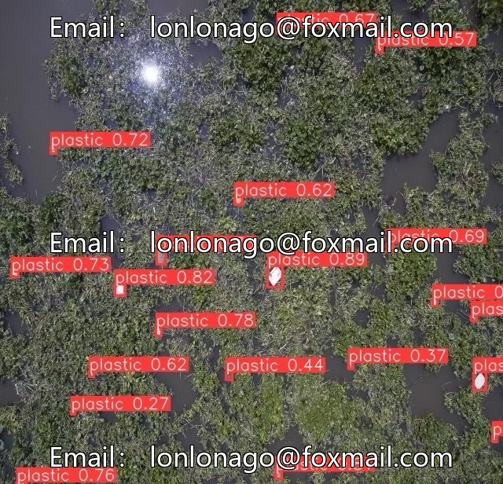
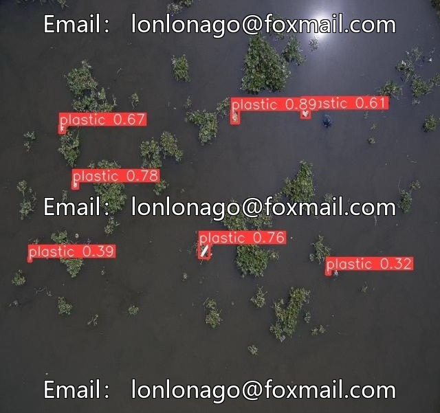
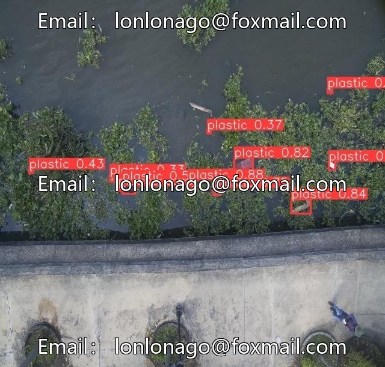
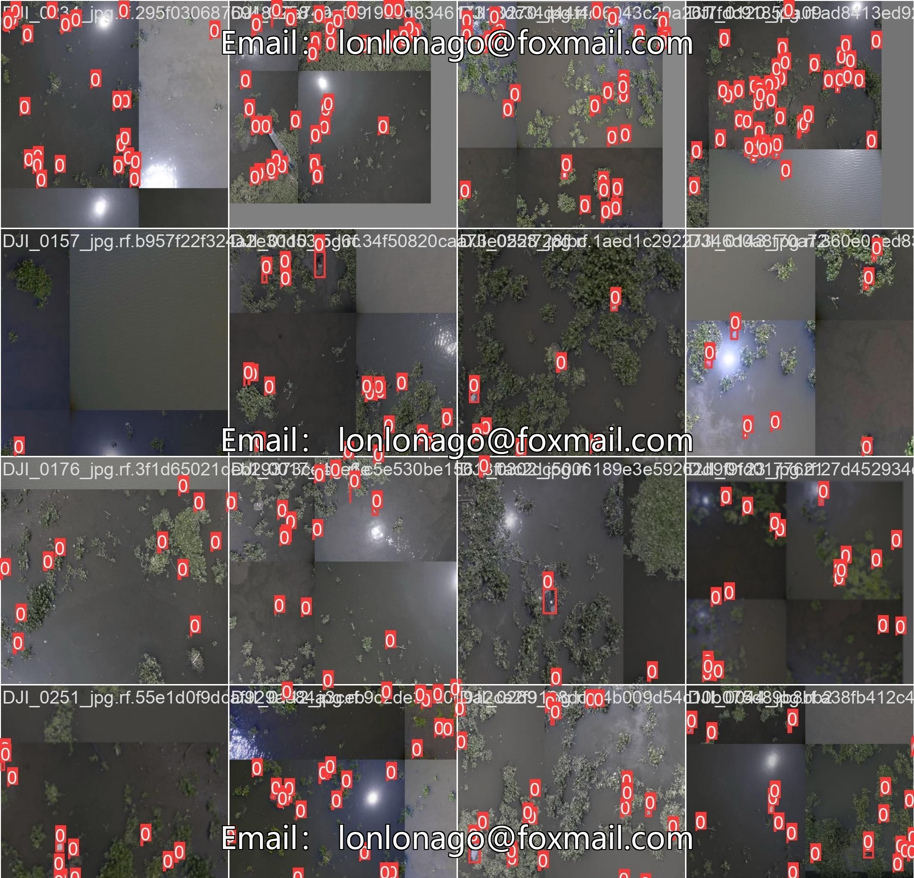

# YOLOv12 River Debris Detection Dataset

## Body

YOLOv12 River Debris Detection Dataset - DJI Drone Plastic Waste Detection on Rivers
The dataset is captured by drones and labeled in the style of YOLOv12, featuring a task of plastic waste detection on rivers. The dataset structure is clear, with training, validation, and test sets all located in the root directory, suitable for training and testing of object detection models.

Dataset Content
- Training set: ../train/images
- Validation set: ../valid/images
- Test set: ../test/images
The format supports mainstream computer vision frameworks, suitable for scenarios such as drone plastic waste detection and environmental monitoring.

Virtual materials, once sold, are non-refundable.
Interested friends, click "I want" to proceed.

## Images

## Payment

Here is a pay link on Stripe ( https://buy.stripe.com/3cs8yP7sY87d0vu9AB ). Please contact me lonlonago@foxmail.com after funding $89, and I will send you a complete data files , thank you!

